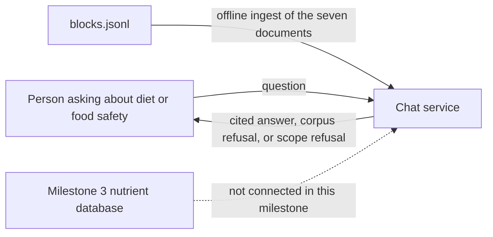
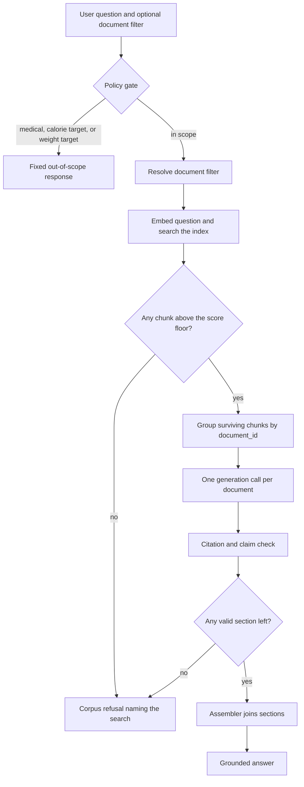

# Architecture

## Dietary Guidance RAG Chatbot

This document describes how to build the prototype in [problemStatement.md](problemStatement.md). The assistant answers questions about food, nutrition, and food safety only from the seven documents in `blocks.jsonl`. Every claim is cited. Questions the documents do not cover are refused. Medical advice, calorie targets, and weight targets are refused in code before any model runs.

Nutrient numbers for individual foods are out of this milestone. They are not ingested, embedded, or answered from model memory. Live authority pages are not crawled. No eighth document is added.

---

## Design rules

These rules decide the shape of the system. A prompt is not enough to hold them.

1. **Scope is a gate, not a suggestion.** Medical advice, calorie targets, and weight targets are rejected by deterministic code. The generator never sees those questions.
2. **The model does not supply facts.** Generation receives only retrieved chunks. If those chunks do not support an answer, the response is a corpus refusal that names what was searched.
3. **One document, one voice.** Chunks are grouped by `document_id`. Each document is answered in its own generation call, which cannot see another publisher's text. A deterministic assembler joins the sections. Nothing in the pipeline is allowed to write "the guidelines say".
4. **Citations are data, not prose.** Each claim points at chunk ids from the retrieval set. Code drops any claim whose ids are missing, foreign to that document, or absent from the chunks just retrieved.
5. **Structure survives ingestion.** The file is already blocks with `heading_path`, list items, and tables. The chunker keeps a section, a list item, and a table row intact enough to cite. Fixed-size splitting is not the chunker.

---

## System context



The chat service is a prototype of the later guidance service: "is this a reasonable way to eat" and "how long can I keep this in the fridge". It does not call a food-composition API, and it does not fetch the original WHO, FAO, Eatwell, FSA, or USDA pages.

The corpus file is:

- Dataset page: https://github.com/saksham20189575/health-data/blob/main/blocks.jsonl
- File to ingest: https://raw.githubusercontent.com/saksham20189575/health-data/main/blocks.jsonl

The dataset page is the citation link. The raw URL is only the bytes the ingest command downloads.

---

## What the user can get back

Every request ends in exactly one of three outcomes. The HTTP body uses the same envelope for all three so the client does not infer scope from a missing field.

| Outcome | When | Who decides | What the person sees |
| --- | --- | --- | --- |
| `grounded_answer` | At least one document's chunks support a claim | Retriever, then per-document generator, then citation check | One section per supporting document. Each claim cites document name, publisher, year, and the dataset link. |
| `not_in_corpus` | Scope passed, but no retrieved chunk supports an answer | Retriever threshold, or the generator abstains and the checker finds no valid claims | The guidance does not cover this, plus the document names and publishers that were searched. |
| `out_of_scope` | Medical advice, a calorie target, or a weight target | Policy gate, before retrieval and before the model | A fixed decline, and a pointer to a qualified professional. |

`not_in_corpus` and `out_of_scope` must not share a template. A calorie target is not "missing from the WHO fact sheet". A fridge question the cold-storage chart does not answer is not medical advice.

---

## Runtime request path



The policy gate is the only component allowed to emit `out_of_scope`. The retriever and the citation check are the only components allowed to emit `not_in_corpus`. The generator is not allowed to choose the outcome label.

---

## Components

### 1. Policy gate

Runs first. No embedding call, no index read, no generation.

It classifies the question with rules in code: phrase lists, units, and a small set of patterns. It does not ask the language model whether the question is allowed. A jailbreak in the question cannot flip the result, because the model is not on this path.

Refuse when the question asks for any of the following:

- A diagnosis, a cause of symptoms, a treatment, a medicine, or whether a condition was caused by food. Example: "Is this rash from something I ate?"
- A calorie target, a deficit, or a daily energy allowance. Example: "How many calories should I eat to lose 5 kg?"
- A body-weight target, a BMI goal, or what a person should weigh.

The response is a constant string. It declines and tells the person to speak to a qualified professional. It does not cite the corpus, because the corpus was not searched.

Do not refuse, at this gate, a question that merely asks what a guidance document says about salt, fat, or food groups. "What does WHO say about free sugars?" is in scope. "How many calories are in an orange?" is also past this gate: it is a nutrient lookup, which this corpus will not answer, and it must come back as `not_in_corpus` after search. Blocking it here would hide the search from the user, and the problem statement requires the assistant to name what it searched.

The rule list lives in one module and is covered by tests. Adding a phrase means adding a test question, not editing a prompt.

### 2. Document resolver

The index can be searched in two modes. Both are required.

- **All documents.** Default. Used for "What does a healthy diet include?" and for cross-document questions such as cooking oil.
- **One named document.** Used when the user names a source, or when the client passes `document_filter`.

The resolver maps aliases onto the manifest `document_id` before retrieval. Aliases name a document, not a topic. "Fridge" alone does not select the cold-storage chart, because the FSA chilling guidance also speaks to fridges.

| Alias examples | `document_id` |
| --- | --- |
| "WHO healthy diet", "fact sheet 394" | `who-healthy-diet` |
| "what are healthy diets", "FAO WHO" | `fao-who-healthy-diets` |
| "Eatwell", "the Eatwell Guide" | `eatwell-guide` |
| "cold food storage", "storage chart" | `cold-food-storage` |
| "FSA chill", "how to chill, freeze and defrost" | `fsa-chill` |
| "five keys" | `who-five-keys` |
| "kitchen companion" | `kitchen-companion` |

Unrecognised text does not become a filter. A filter that matches nothing is a client error, not a corpus refusal.

Resolution is a lookup table in the manifest, not a model guess. If the resolver and an explicit `document_filter` disagree, the explicit filter wins.

### 3. Corpus store

Offline, and the source of truth for metadata. The vector index is a derivative. If they disagree, the store wins and the index is rebuilt.

`blocks.jsonl` is downloaded once and kept at `corpus/blocks.jsonl`. Each line is one block:

| Field | Meaning |
| --- | --- |
| `document_id` | Document key. Same value as `doc_id` in the index. |
| `ordinal` | Order inside that document. |
| `type` | `heading`, `paragraph`, `list_item`, or `table`. |
| `text` | Prose, list item, or markdown table. |
| `heading_path` | Section headings from the document root down to this block. |
| `page` | Page number, when the source was a PDF. |
| `level` | Heading level, on heading blocks. |
| `header`, `rows` | On table blocks, beside the markdown in `text`. |

The JSONL does not carry publisher, year, source URL, or retrieval date. Those live in the manifest and are copied onto every document and every chunk.

Each document record holds:

| Field | Use |
| --- | --- |
| `doc_id` | The `document_id` from the file. Filter key and chunk foreign key. |
| `document_name` | Citation title. |
| `publisher` | Citation publisher, from the manifest. |
| `year` | Citation year, from the manifest. |
| `source_url` | Citation link. The dataset page, for every document. |
| `retrieval_date` | The day `blocks.jsonl` was ingested. |
| `aliases` | Strings the resolver accepts. |

`source_url` is https://github.com/saksham20189575/health-data/blob/main/blocks.jsonl for all seven documents. A citation distinguishes documents by `document_name`, `publisher`, `year`, and `section_heading`, not by seven different links.

A later ingest replaces the stored file, writes a new retrieval date, rebuilds chunks for the documents whose blocks changed, and replaces those `doc_id`s in the index. It does not fetch the publishers' websites.

### 4. Loader

There is no HTML parser and no page fetcher. The loader reads `corpus/blocks.jsonl`, checks that the set of `document_id` values is exactly the seven ids in the manifest, and groups blocks by `document_id` sorted by `ordinal`.

It does not summarise a block. It does not drop a block because it looks like a header or a footer. It does not invent blocks for text that is only in a figure. The Eatwell plate is represented by the prose and food-group sections already in `eatwell-guide`. An image description from a model is not a source.

If the download fails, or any of the seven ids is missing, or an unknown id appears, the command exits and does not index a partial corpus.

### 5. Chunker

Chunking walks the blocks of one document in `ordinal` order. The unit of retrieval is a passage a citation can stand on.

**Section chunks.** A heading block opens or changes the section. Following `paragraph` and `list_item` blocks that share that `heading_path` join the section until the next heading changes it. `section_heading` is the last entry of `heading_path`. The heading text is stored on the chunk and included in the embedded string.

**List items.** A `list_item` is never cut in half. If a section exceeds the token budget, split on list-item boundaries, then on paragraphs. Each child chunk repeats `section_heading`. A recommendation stays in the same chunk as the food or practice it applies to.

**Tables.** A `table` block is one chunk. `section_heading` is the last entry of its `heading_path`. The header stays attached to the body. A table is not cut at a token boundary mid-row. `cold-food-storage` is one table: a citation must keep each food, its refrigerator time, and its freezer time on the same row. If that table exceeds `table_token_hard_cap`, split by row groups, repeat `header` on every piece, and set `table_part`. Do not split a row across pieces.

**Metadata copied onto every chunk.**

| Field | Required |
| --- | --- |
| `chunk_id` | Yes. Stable id from `doc_id` plus the ordinal range. |
| `doc_id` | Yes |
| `document_name` | Yes |
| `publisher` | Yes |
| `year` | Yes |
| `source_url` | Yes. The dataset page. |
| `retrieval_date` | Yes |
| `section_heading` | Yes |
| `text` | Yes |
| `ordinal_start`, `ordinal_end` | Yes |
| `table_part` | Only for a split table |

`document_name`, `publisher`, `year`, and `section_heading` are the fields the problem statement requires on every chunk. `source_url` is stored as well so the citation link does not need a join at answer time.

**What this costs.** Chunks are larger and fewer than a fixed window, so a narrow question can retrieve a whole section of neighbouring advice. A table that stays whole dominates its embedding: one leftover row is harder to retrieve from the full cold-storage chart. Row-group splits fix that and repeat the header, which spends budget. `kitchen-companion` is hundreds of blocks, so an uncapped section from it can crowd out a shorter document. The README states the budgets, the chunk count per document, and which tables were split.

Fixed-size chunking with overlap is not used. It cuts list items and table rows in half, and the citation then says something the source did not say as a unit.

### 6. Embeddings and the vector index

One embedding model encodes chunks at ingest and questions at query time. The same model and the same input template are used for both. A chunk's embedded text is the section heading followed by the chunk body, so "Fats" or "Cold Food Storage Chart" is part of the vector and not only a metadata field.

The index stores the vector plus the chunk metadata above. It supports:

- top-k search over every chunk
- the same search restricted with a metadata filter on `doc_id`

Filtering happens in the index query, not by searching everything and discarding. A question about the Eatwell Guide must not spend its k on cold-storage rows.

The index is rebuilt from the corpus store. It is not edited chunk-by-chunk in place. Re-ingesting one document deletes that `doc_id` and writes the new chunks.

Prototype default: a local vector store that can filter on metadata (Chroma or an equivalent). The embedding model is swappable behind one interface. Persist the index on disk so a restart does not re-embed.

### 7. Retriever

Inputs: the question text, the resolved `doc_id` or "all", and `k`.

Steps:

1. Embed the question.
2. Query the index, with a `doc_id` filter when one was resolved.
3. Drop chunks below the score floor.
4. Keep at most `k` chunks, and at most `m` chunks from any single document, so `kitchen-companion` cannot fill the window.

The score floor is what turns a weak neighbour into "not covered". If nothing remains, return `not_in_corpus` and include the search record: either the one filtered document, or every document in the manifest, each with `document_name` and `publisher`.

The retriever does not write sentences. It returns chunks and the search record.

### 8. Per-document generator

Surviving chunks are grouped by `doc_id`. Documents with no surviving chunks do not get a section and do not get a generation call.

Each call receives:

- the question
- only that document's chunks, each labelled with `chunk_id` and `section_heading`
- an instruction to use those chunks alone, to abstain if they do not contain the answer, and to attach `chunk_id`s to every claim

Each call returns structured claims, or an abstain:

```json
{
  "doc_id": "cold-food-storage",
  "abstain": false,
  "claims": [
    {
      "text": "Leftover cooked meat or poultry keeps 3 to 4 days in the refrigerator.",
      "chunk_ids": ["cold-food-storage-t1"]
    }
  ]
}
```

The model is told not to compare this document with any other authority, because no other authority is in the context. It cannot see the FSA chilling blocks while writing a USDA chart claim. That is what stops a blended sentence.

Abstain is required when the chunks are about the same broad topic but do not state the fact asked for. The cold-storage chart states a hold time only for the food on that row. A food that is not a row does not gain a time from the model, and `fsa-chill` does not gain a USDA hold time. The claim is omitted. If every document abstains, the outcome becomes `not_in_corpus`.

Generation parameters stay low temperature. The prototype uses one chat model behind an interface. The model is not the system of record for citations; the next stage is.

### 9. Citation check

For each claim, in code:

- `chunk_ids` is non-empty
- every id was in this document's retrieval set for this request
- every id belongs to the same `doc_id` as the section
- the claim text is non-empty

A claim that fails is dropped. It is not rewritten by another model call. If a document loses every claim, that section is dropped. If every section is dropped, the outcome is `not_in_corpus` and the response names the documents that were searched.

Citation fields shown to the user are read from chunk metadata, not from the model's wording: `document_name`, `publisher`, `year`, `source_url`, and `section_heading`. The model cannot invent a publisher or a year.

### 10. Assembler

The assembler concatenates the surviving sections in manifest order. It does not call a model. It does not add a concluding sentence that merges the sections into one recommendation.

Rendered shape:

```text
WHO Healthy diet, Fact sheet N°394 — World Health Organization, <year from the manifest>
https://github.com/saksham20189575/health-data/blob/main/blocks.jsonl
- Claim text. (section heading)

The Eatwell Guide — UK Government (Public Health England), <year from the manifest>
https://github.com/saksham20189575/health-data/blob/main/blocks.jsonl
- Claim text. (section heading)
```

The year is the manifest value copied onto the chunk at ingest. Both sections share the dataset URL. The document name, publisher, and section heading are what tell them apart.

Agreement between two sections is allowed to be visible because both sections are present. The assembler must not add "both authorities agree" unless that sentence is itself a claim tied to chunks, which it cannot be, because no chunk says that. So the assembler adds no such sentence.

### 11. Chat API

One endpoint is enough for the prototype.

`POST /ask`

```json
{
  "question": "How long can leftover cooked chicken stay in the fridge?",
  "document_filter": null
}
```

`document_filter` is optional. It accepts a `document_id` or an alias. Omit it to search the whole corpus.

Response envelope:

```json
{
  "outcome": "grounded_answer",
  "searched": [
    {
      "doc_id": "cold-food-storage",
      "document_name": "Cold Food Storage Chart",
      "publisher": "U.S. Department of Agriculture, Food Safety and Inspection Service"
    }
  ],
  "sections": [
    {
      "document_name": "Cold Food Storage Chart",
      "publisher": "U.S. Department of Agriculture, Food Safety and Inspection Service",
      "year": 2024,
      "source_url": "https://github.com/saksham20189575/health-data/blob/main/blocks.jsonl",
      "claims": [
        {
          "text": "...",
          "section_heading": "Cold Food Storage Chart",
          "chunk_ids": ["cold-food-storage-t1"]
        }
      ]
    }
  ],
  "message": null
}
```

`year` in that envelope is the manifest value. The number above only shows the field.

For `not_in_corpus`, `sections` is empty and `message` states that the guidance does not cover the question. `searched` lists what was actually queried.

For `out_of_scope`, `sections` is empty, `searched` is empty, and `message` is the fixed decline. Empty `searched` is how a client can tell the corpus was not consulted.

A single-page chat client posts to `/ask` and renders sections, or renders `message` when the outcome is not `grounded_answer`. The client does not merge sections.

---

## Offline ingest path


Ingest is a command, not a request path. The chat process only reads the index and the metadata.

Manifest entries for this prototype. Every row uses the same source URL, https://github.com/saksham20189575/health-data/blob/main/blocks.jsonl.

| `doc_id` | Document | Publisher | Role |
| --- | --- | --- | --- |
| `who-healthy-diet` | WHO Healthy diet, Fact sheet N°394 | World Health Organization | What a healthy diet includes |
| `fao-who-healthy-diets` | What are healthy diets? | FAO and WHO | Principles of a healthy diet |
| `eatwell-guide` | The Eatwell Guide | UK Government (Public Health England) | Food groups |
| `cold-food-storage` | Cold Food Storage Chart | USDA Food Safety and Inspection Service | Fridge and freezer hold times |
| `fsa-chill` | How to chill, freeze and defrost food safely | UK Food Standards Agency | Chill, freeze, and defrost |
| `who-five-keys` | Five Keys to Safer Food | World Health Organization | Safe preparation |
| `kitchen-companion` | Kitchen Companion | USDA Food Safety and Inspection Service | Kitchen food safety |

How to eat: `who-healthy-diet`, `fao-who-healthy-diets`, `eatwell-guide`.

How to keep food safe: `cold-food-storage`, `fsa-chill`, `who-five-keys`, `kitchen-companion`.

The manifest is closed. Do not add an eighth document. Nutrient databases and anything with a clean API stay out.

---

## How the hard questions move through the system

**"What does a healthy diet include?"**
Policy gate passes. No document is named, so retrieval is global. `who-healthy-diet` and `fao-who-healthy-diets` each get a generation call when their chunks clear the floor. `eatwell-guide` gets one only when its own chunks do. The assembler prints one section per document. Claims about fruit, vegetables, fats, sugars, or salt stay inside the document that stated them.

**"How does the Eatwell Guide divide food groups?"**
The resolver sets `doc_id` to `eatwell-guide`. The index filter excludes the WHO, FAO, FSA, and USDA documents. One section comes back, cited to the Eatwell Guide.

**"How should I handle raw meat when cooking?"**
Global retrieval. `who-five-keys` is expected to clear the floor. `kitchen-companion` is included only if its own chunks also clear the floor. Separate sections. Neither section is rewritten to agree with the other.

**"What temperature should my fridge be, and how long can leftovers stay there?"**
Global retrieval. `cold-food-storage` can supply a hold time only when the claim cites the row that states it. `fsa-chill` can supply a chilling or fridge fact only when its own chunks state it. A hold time that is not in the cited row is not added. If one document answers and the other abstains, the answer is still `grounded_answer`, with one section. It becomes `not_in_corpus` only when no claim survives.

**"Which oil should I use, and is it safe to reuse?"**
Global retrieval. Diet documents (`who-healthy-diet`, `fao-who-healthy-diets`, `eatwell-guide`) and safety documents (`who-five-keys`, `kitchen-companion`, `fsa-chill`) can both contribute, in separate generation calls. A diet call does not receive safety chunks, so it cannot fold a storage rule into a nutrition sentence. The assembler places the sections one after another and adds no synthesis.

**"How many calories should I eat to lose 5 kg?"**
The policy gate matches a calorie target and a weight target. Response is `out_of_scope`. `searched` is empty.

**"What is the vitamin C content of an orange?"**
The policy gate does not match. Retrieval runs across the seven documents. They do not state that nutrient amount. Nothing clears the floor, or the generator abstains. Response is `not_in_corpus` and names the documents searched. The answer does not quote a number from the model.

**"Is this rash from something I ate?"**
The policy gate matches medical advice. `out_of_scope`. The index is not queried.

---

## Module layout

```text
docs/
  problemStatement.md
  architecture.md
corpus/
  manifest.yaml          # seven document ids, publishers, years, aliases
  blocks.jsonl           # downloaded corpus, the only prose source
  parsed/                # per-document metadata and chunk jsonl
  index/                 # persisted vector index
src/
  policy/
    gate.py              # out-of-scope rules and the fixed message
  ingest/
    load.py              # download blocks.jsonl and group by document_id
    chunk.py             # heading_path, list items, table rows
    embed_index.py
  retrieval/
    resolve.py           # alias and document_filter
    search.py            # embed, filter, score floor, per-doc cap
  answer/
    generate.py          # one call per document
    citations.py         # drop invalid claims
    assemble.py          # join sections, no model
  api/
    ask.py               # POST /ask, wires the path
  schemas.py             # question, chunk, claim, response envelope
tests/
  test_policy.py         # scope refusals never reach retrieval
  test_chunker.py        # list items and table rows stay whole
  test_retrieval.py      # global search and single-doc filter
  test_citations.py      # foreign chunk ids are dropped
  test_assemble.py       # two documents stay two sections
```

`ask.py` is the only place that orders the stages. Tests can call the gate, the chunker, and the citation check without a live model. Chunker tests use fixture blocks, including one cold-storage row, and do not need the network.

---

## Configuration

| Setting | Role |
| --- | --- |
| `corpus_url` | Raw URL of `blocks.jsonl`. |
| `source_url` | Dataset page written onto every citation. |
| `score_floor` | Minimum similarity. Below it, the chunk is not evidence. |
| `k` | Maximum chunks returned for a question. |
| `m` | Maximum chunks from one document, so `kitchen-companion` cannot crowd out the others. |
| `chunk_token_budget` | Split point for oversized sections. Tables prefer to stay whole past this budget until the hard table cap. |
| `table_token_hard_cap` | Above this, a table splits by row groups with a repeated header. |
| embedding model id | Must match between ingest and query. |
| chat model id | Used only inside `generate.py`. |

Thresholds are configuration so evaluation can tune them without changing the refusal rules.

---

## Evaluation

The example questions in the problem statement are the acceptance set. Each one is an automated check against `outcome`, and against which `doc_id`s appear in `sections`.

| Question | Outcome | Documents in the answer |
| --- | --- | --- |
| What does a healthy diet include? | `grounded_answer` | `who-healthy-diet` and `fao-who-healthy-diets`. `eatwell-guide` only as its own section, and only if its chunks support a claim. |
| How does the Eatwell Guide divide food groups? | `grounded_answer` | `eatwell-guide` only |
| How should I handle raw meat when cooking? | `grounded_answer` | `who-five-keys`, plus `kitchen-companion` only when its chunks support a claim |
| Fridge temperature and leftover time | `grounded_answer` | `cold-food-storage` and `fsa-chill` only where each document states the fact. No hold-time claim unless the cited row or section states one. |
| Which oil, and is reuse safe? | `grounded_answer` | Diet ids and safety ids as separate sections. No section cites both a diet `doc_id` and a safety `doc_id`. |
| How many calories should I eat to lose 5 kg? | `out_of_scope` | none, and `searched` empty |
| Vitamin C in an orange | `not_in_corpus` | none, and `searched` lists the seven documents |
| Is this rash from something I ate? | `out_of_scope` | none, and `searched` empty |

Diet ids are `who-healthy-diet`, `fao-who-healthy-diets`, and `eatwell-guide`. Safety ids are `who-five-keys`, `kitchen-companion`, and `fsa-chill`.

A further check scans `grounded_answer` claims and fails the run if any `chunk_id` is outside the retrieval set for that request.

---

## Failure behaviour

| Failure | Result |
| --- | --- |
| Policy match | `out_of_scope`. No retrieval. |
| Unknown `document_filter` | HTTP 400. The corpus was not searched. This is not `not_in_corpus`. |
| Index empty or embed error | HTTP 503. Do not answer from the model with an empty context. |
| Score floor removes every chunk | `not_in_corpus`, with the search record. |
| Model abstains or citation check drops every claim | `not_in_corpus`, with the search record. |
| Model returns a chunk id from another document | That claim is dropped. |
| Download fails, or `blocks.jsonl` does not contain exactly the seven manifest ids | Ingest exits with an error. Nothing new is indexed. A partial corpus is worse than a failed ingest. |

---

## What this architecture deliberately leaves out

- A nutrient database, a food API, or any client that could fill in a vitamin number.
- Crawling the live WHO, FAO, Eatwell, FSA, or USDA pages, or adding an eighth document.
- A final model pass that "smooths" the sections into one voice.
- A prompt-only refusal for medical advice or weight targets.
- Chat memory that carries an earlier answer in as evidence. Each question is retrieved on its own. A follow-up may repeat the previous user text if the client sends it, but previous model answers are not chunks and are not retrievable.
- Image understanding of the Eatwell plate as a source of claims.
