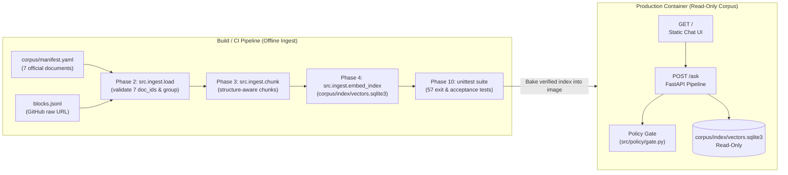

# Deployment Plan — Dietary Guidance RAG Chatbot

This document specifies how to package, deploy, verify, and operate the Dietary Guidance RAG Chatbot (`POST /ask` + `GET /`) in a production or cloud staging environment while preserving every architectural invariant in [architecture.md](architecture.md) and [implementation-plan.md](implementation-plan.md).

---

## 1. Deployment Architecture Overview

The application is deployed as a **single stateless web service** (FastAPI + Uvicorn) paired with an **immutable, pre-built corpus & vector index artifact** generated during the build phase.



### Key Deployment Principles
1. **Ingest happens at build time, never on the live request path.** The runtime container starts with `corpus/parsed/*.chunks.jsonl` and `corpus/index/vectors.sqlite3` already built and verified.
2. **Fail-closed corpus validation.** If `blocks.jsonl` cannot be downloaded at build time, or if any of the seven manifest documents is missing or an eighth document appears, the image build fails immediately.
3. **Stateless request handling.** Every `POST /ask` call is independent. Horizontal scaling requires no shared session state.
4. **Identical embedding configuration between build and runtime.** `embedding_model_id` and `OPENAI_API_KEY` (if using OpenAI embeddings instead of the built-in deterministic local embeddings) must match between the image build step that creates `vectors.sqlite3` and the runtime service that embeds user queries.

---

## 2. Prerequisites & Environment Variables

### Runtime Stack
- **Python:** 3.11+
- **ASGI Server:** `uvicorn` (or `gunicorn -k uvicorn.workers.UvicornWorker`)
- **Dependencies:** Listed in `requirements.txt`

### Environment Variables

| Variable | Required | Default | Description |
| --- | --- | --- | --- |
| `PORT` | No | `8000` | HTTP port bound by Uvicorn inside the container. |
| `WEB_CONCURRENCY` | No | `2` | Number of Uvicorn worker processes. |
| `OPENAI_API_KEY` | Optional | *(unset)* | When set, uses OpenAI `text-embedding-3-small` and `gpt-4o-mini` (`temperature=0.0`, JSON mode). When unset, uses the built-in deterministic local embeddings and extractive generator. |

> **Important:** Do not build the index without `OPENAI_API_KEY` and then set `OPENAI_API_KEY` only at runtime (or vice versa), as query vectors and indexed chunk vectors must come from the same embedding model.

---

## 3. Containerization (`Dockerfile` & `.dockerignore`)

### 3.1 `.dockerignore`

Create `.dockerignore` at the repository root so local temporary files or unverified indices are not copied into the build context:

```text
__pycache__/
*.pyc
.pytest_cache/
.venv/
venv/
.git/
corpus/blocks.jsonl
corpus/parsed/*.json
corpus/parsed/*.chunks.jsonl
corpus/index/*.sqlite3
```

### 3.2 `Dockerfile`

Create `Dockerfile` at the repository root. It installs dependencies, runs the offline ingest pipeline (`load` $\rightarrow$ `chunk` $\rightarrow$ `embed_index`), executes the full 57-test acceptance suite, and starts the non-root Uvicorn server:

```dockerfile
FROM python:3.12-slim

ENV PYTHONDONTWRITEBYTECODE=1 \
    PYTHONUNBUFFERED=1 \
    PORT=8000 \
    WEB_CONCURRENCY=2

WORKDIR /app

# 1. Install Python dependencies
COPY requirements.txt .
RUN pip install --no-cache-dir -r requirements.txt

# 2. Copy source code, manifest, and tests
COPY corpus/manifest.yaml ./corpus/manifest.yaml
COPY src/ ./src/
COPY tests/ ./tests/
COPY README.md ./README.md

# 3. Run offline ingest pipeline at build time (Phases 2 -> 3 -> 4)
# Optional: pass --build-arg OPENAI_API_KEY=... if using OpenAI embeddings
ARG OPENAI_API_KEY=""
ENV OPENAI_API_KEY=${OPENAI_API_KEY}

RUN python3 -m src.ingest.load && \
    python3 -m src.ingest.chunk && \
    python3 -m src.ingest.embed_index

# 4. Gate image build on all 57 unit and acceptance tests passing
RUN python3 -m unittest discover -s tests -p "test_*.py" -v

# 5. Run as an unprivileged user in production
RUN useradd --create-home appuser && chown -R appuser:appuser /app
USER appuser

EXPOSE 8000

CMD ["sh", "-c", "python3 -m uvicorn src.api.ask:app --host 0.0.0.0 --port ${PORT} --workers ${WEB_CONCURRENCY}"]
```

---

## 4. Step-by-Step Deployment Options

### Option A: Local / VM Production Deployment (Systemd or Docker)

1. **Build the Docker image:**
   ```bash
   docker build -t dietary-guidance-rag:latest .
   ```
2. **Run the container:**
   ```bash
   docker run -d \
     --name dietary-guidance-rag \
     -p 8000:8000 \
     --restart unless-stopped \
     dietary-guidance-rag:latest
   ```
3. **Verify logs:**
   ```bash
   docker logs -f dietary-guidance-rag
   ```

### Option B: Cloud Container Platform (Render / Railway / Fly.io / Google Cloud Run / AWS App Runner)

1. **Connect Repository:** Point the service to the repository root containing the `Dockerfile`.
2. **Configure Build & Start Commands (if deploying without Docker):**
   - **Build Command:**
     ```bash
     pip install -r requirements.txt && python3 -m src.ingest.load && python3 -m src.ingest.chunk && python3 -m src.ingest.embed_index && python3 -m unittest discover -s tests -p "test_*.py"
     ```
   - **Start Command:**
     ```bash
     python3 -m uvicorn src.api.ask:app --host 0.0.0.0 --port $PORT --workers 2
     ```
3. **Health Check Path:** Configure the platform health check to `GET /` expecting HTTP `200 OK`.

### Option C: Streamlit Community Cloud Deployment (`streamlit_app.py`)

The repository includes `streamlit_app.py` and `.streamlit/config.toml` so the project can be deployed directly to **Streamlit Community Cloud** (or run locally with `streamlit run streamlit_app.py`):

1. **Push the repository to GitHub** (including `streamlit_app.py`, `.streamlit/config.toml`, `requirements.txt`, `corpus/manifest.yaml`, and `src/`).
2. **Create a new app on [share.streamlit.io](https://share.streamlit.io/):**
   - **Repository:** Select your GitHub repository and branch.
   - **Main file path:** `streamlit_app.py`
3. **Optional Secrets (`App settings` $\rightarrow$ `Secrets`):**
   - The app works out-of-the-box with zero secrets using the deterministic local embeddings and extractive generator.
   - If you wish to use OpenAI models, add `OPENAI_API_KEY = "sk-..."` in Streamlit Secrets (which `src/ingest/embed_index.py` and `src/answer/generate.py` read automatically via `st.secrets`).
4. **Cold-Start Auto-Ingest:**
   - On cold start, `ensure_corpus_and_index()` in `streamlit_app.py` (decorated with `@st.cache_resource`) checks if `corpus/index/vectors.sqlite3` is present; if not, it automatically runs Phases 2 $\rightarrow$ 3 $\rightarrow$ 4 (`load_corpus`, `chunk_all_documents`, `build_index`) once and caches the ready `VectorIndex` across sessions.

---

## 5. Post-Deployment Smoke & Acceptance Checks

Run these automated `curl` checks against the deployed `$BASE_URL` (e.g. `http://127.0.0.1:8000` or your production domain) before marking a release healthy:

### Check 1: Frontend Chat UI (`GET /`)
```bash
curl -s -o /dev/null -w "%{http_code}\n" "$BASE_URL/"
# Expected: 200
```

### Check 2: Grounded Single-Document Answer (`eatwell-guide` alias resolution)
```bash
curl -s -X POST "$BASE_URL/ask" \
  -H "Content-Type: application/json" \
  -d '{"question": "How does the Eatwell Guide divide food groups?"}'
# Expected: HTTP 200, "outcome": "grounded_answer", only "eatwell-guide" in "sections"
```

### Check 3: Grounded Multi-Document Answer (separate sections, no synthesis)
```bash
curl -s -X POST "$BASE_URL/ask" \
  -H "Content-Type: application/json" \
  -d '{"question": "What temperature should my fridge be, and how long can leftovers stay there?"}'
# Expected: HTTP 200, "outcome": "grounded_answer", separate sections for "cold-food-storage" and "fsa-chill"
```

### Check 4: Corpus Refusal (`not_in_corpus` naming all 7 searched documents)
```bash
curl -s -X POST "$BASE_URL/ask" \
  -H "Content-Type: application/json" \
  -d '{"question": "What is the vitamin C content of an orange?"}'
# Expected: HTTP 200, "outcome": "not_in_corpus", "sections": [], "searched" has 7 documents
```

### Check 5: Policy Gate Scope Refusal (`out_of_scope` with empty `searched`)
```bash
curl -s -X POST "$BASE_URL/ask" \
  -H "Content-Type: application/json" \
  -d '{"question": "Is this rash from something I ate?"}'
# Expected: HTTP 200, "outcome": "out_of_scope", "searched": [], "sections": []
```

### Check 6: Client Error on Unknown `document_filter` (HTTP 400)
```bash
curl -s -o /dev/null -w "%{http_code}\n" -X POST "$BASE_URL/ask" \
  -H "Content-Type: application/json" \
  -d '{"question": "What does a healthy diet include?", "document_filter": "not-a-document"}'
# Expected: 400
```

---

## 6. Corpus Re-Ingestion & Rollback Strategy

### Updating or Re-Ingesting the Corpus
Because `corpus/index/vectors.sqlite3` is baked into the deployment artifact at build time:
1. Trigger a new build (`docker build --no-cache ...` or CI pipeline run) to re-run:
   - `python3 -m src.ingest.load` (updates `retrieval_date` to today's ISO date and validates the 7 `document_id`s)
   - `python3 -m src.ingest.chunk` (regenerates `.chunks.jsonl`)
   - `python3 -m src.ingest.embed_index` (rebuilds `corpus/index/vectors.sqlite3`)
   - `python3 -m unittest discover -s tests -p "test_*.py" -v`
2. If you need to re-ingest a single document locally without rebuilding the other six:
   ```python
   from src.ingest.embed_index import build_index
   build_index(doc_id="fsa-chill")
   ```

### Failure & Rollback Guarantees
- **Build-time ingest failure:** If the upstream `blocks.jsonl` download fails or schema validation fails, `src.ingest.load` exits non-zero and the Docker build aborts before replacing the running container.
- **Runtime index unavailability:** If `corpus/index/vectors.sqlite3` is missing or corrupted at runtime, `POST /ask` returns **HTTP 503** (`Service Unavailable`) and never invokes the generator with an empty context.
- **Instant rollback:** Because the application is stateless and the corpus index is bundled inside the image tag, rolling back to the previous image tag immediately restores both code and the exact verified corpus index.
