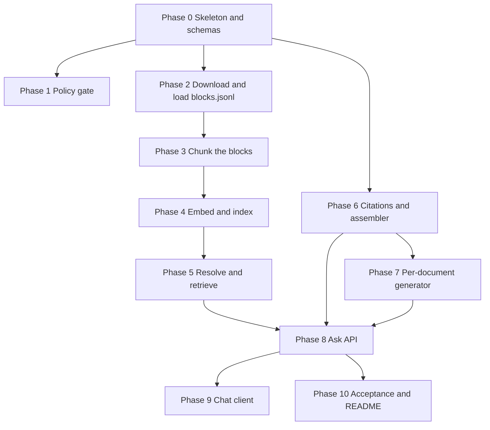

# Implementation Plan

## Dietary Guidance RAG Chatbot

This plan builds the prototype in [problemStatement.md](problemStatement.md) the way [architecture.md](architecture.md) specifies it. Work proceeds in phases. A phase is finished only when its exit checks pass. Later phases call the earlier ones. They do not reimplement them.

The assistant answers from the seven documents in `blocks.jsonl`. Every claim is cited. Medical advice, calorie targets, and weight targets are refused in code. Questions the documents do not cover are refused separately, and the refusal names what was searched.

Nutrient numbers for individual foods are not part of any phase. Do not add a food API, a composition database, or a model call that fills those numbers in. Do not crawl the live WHO, FAO, Eatwell, FSA, or USDA pages, and do not add an eighth document.

---

## How to use the phases

Build in order. Phases 1 through 6 do not need a chat model. Phase 7 is the first one that does. That split is deliberate: the policy gate, the loader, the chunker, the citation check, and the assembler must be correct before a model is allowed to write sentences.

Each phase lists the files it creates, the work inside them, and the checks that mark it done. Do not start the next phase while an exit check is still failing.

Stack for the prototype:

- Python 3.11+
- FastAPI for `POST /ask`
- Pydantic for the request and response envelope
- A local metadata-filtering vector store (Chroma, or an equivalent with the same interface)
- One embedding model, used both at ingest and at query time
- One chat model, used only inside the per-document generator
- pytest for the exit checks that do not need a live model

Model ids and thresholds live in configuration, not in the modules that enforce refusals.

---

## Phase 0 — Repository skeleton

**Goal.** A layout the rest of the phases can fill, with shared types and settings, and no behaviour yet.

**Create.**

```text
corpus/manifest.yaml
corpus/parsed/.gitkeep
corpus/index/.gitkeep
src/schemas.py
src/config.py
src/policy/gate.py          # empty module, filled in Phase 1
src/ingest/load.py
src/ingest/chunk.py
src/ingest/embed_index.py
src/retrieval/resolve.py
src/retrieval/search.py
src/answer/generate.py
src/answer/citations.py
src/answer/assemble.py
src/api/ask.py
tests/test_policy.py
tests/test_chunker.py
tests/test_retrieval.py
tests/test_citations.py
tests/test_assemble.py
requirements.txt
README.md
```

**Work.**

- Define the response envelope in `schemas.py`: `outcome` is `grounded_answer`, `not_in_corpus`, or `out_of_scope`. Fields are `searched`, `sections`, and `message`. The same model is used for all three outcomes. No field is omitted to signal a refusal.
- Define block, chunk, claim, document, and ask-request models to match the architecture. A block has `document_id`, `ordinal`, `type`, `text`, `heading_path`, and optional `page`, `level`, `header`, and `rows`. A chunk carries `chunk_id`, `doc_id`, `document_name`, `publisher`, `year`, `source_url`, `retrieval_date`, `section_heading`, `text`, `ordinal_start`, `ordinal_end`, and optional `table_part`.
- Put `corpus_url`, `source_url`, `score_floor`, `k`, `m`, `chunk_token_budget`, `table_token_hard_cap`, the embedding model id, and the chat model id in `config.py`.
  - `corpus_url` is https://raw.githubusercontent.com/saksham20189575/health-data/main/blocks.jsonl
  - `source_url` is https://github.com/saksham20189575/health-data/blob/main/blocks.jsonl
- Write `corpus/manifest.yaml` with the seven documents below. Every document uses the same `source_url`. Fill `publisher`, `year`, and `aliases` here. The JSONL does not contain them. Leave `retrieval_date` blank until ingest. Aliases name a document, not a topic: "fridge" alone must not select `cold-food-storage`.

| `doc_id` | Document | Publisher |
| --- | --- | --- |
| `who-healthy-diet` | WHO Healthy diet, Fact sheet N°394 | World Health Organization |
| `fao-who-healthy-diets` | What are healthy diets? | FAO and WHO |
| `eatwell-guide` | The Eatwell Guide | UK Government (Public Health England) |
| `cold-food-storage` | Cold Food Storage Chart | USDA Food Safety and Inspection Service |
| `fsa-chill` | How to chill, freeze and defrost food safely | UK Food Standards Agency |
| `who-five-keys` | Five Keys to Safer Food | World Health Organization |
| `kitchen-companion` | Kitchen Companion | USDA Food Safety and Inspection Service |

Aliases to include: "WHO healthy diet", "fact sheet 394", "what are healthy diets", "FAO WHO", "Eatwell", "the Eatwell Guide", "cold food storage", "storage chart", "FSA chill", "how to chill, freeze and defrost", "five keys", "kitchen companion".

**Exit.** The package imports. The manifest lists exactly those seven ids and one shared source URL. Schemas round-trip a fixture of each outcome. Ingest will later refuse a document whose `year` is still blank.

**Do not do yet.** Downloading `blocks.jsonl`, calling a model, or writing refusal copy inside the API.

---

## Phase 1 — Policy gate

**Goal.** Medical advice, calorie targets, and weight targets are refused by deterministic code. The generator never sees those questions.

**Files.** `src/policy/gate.py`, `tests/test_policy.py`.

**Work.**

- Implement a `check(question) -> allow | out_of_scope` function. It uses phrase lists, units, and patterns. It does not call an embedding model, the index, or the chat model.
- Refuse questions that ask for a diagnosis, a cause of symptoms, a treatment, a medicine, or whether a condition was caused by food.
- Refuse calorie targets, deficits, and daily energy allowances.
- Refuse body-weight targets, BMI goals, and questions about what someone should weigh.
- Return one fixed message. It declines and points the person to a qualified professional. It does not mention a document, because nothing was searched.
- Let these through: questions about what a document says on salt, fat, or food groups, and nutrient lookups such as "How many calories are in an orange?". Those are corpus questions. Refusing them here would hide the search the problem statement requires the assistant to name.

**Exit checks.**

| Question | Result |
| --- | --- |
| Is this rash from something I ate? | `out_of_scope` |
| How many calories should I eat to lose 5 kg? | `out_of_scope` |
| What should I weigh? | `out_of_scope` |
| What does WHO say about free sugars? | allowed |
| How many calories are in an orange? | allowed |
| What temperature should my fridge be? | allowed |

A test patches the retriever and fails if an `out_of_scope` question calls it. Adding a new blocked phrase means adding a test question in the same change.

---

## Phase 2 — Download and load the corpus

**Goal.** `blocks.jsonl` is on disk, grouped into the seven manifest documents, with publisher, year, source URL, and retrieval date stored beside the blocks.

**Files.** `src/ingest/load.py`, `corpus/blocks.jsonl`, `corpus/parsed/<doc_id>.json`.

**Work.**

- Download `corpus_url` to `corpus/blocks.jsonl`. If the download fails, exit with an error and do not write a partial index.
- Parse each line as one block. Require `document_id`, `ordinal`, `type`, `text`, and `heading_path`. Keep `page`, `level`, `header`, and `rows` when present. `type` is `heading`, `paragraph`, `list_item`, or `table`.
- Check that the set of `document_id` values is exactly the seven manifest ids. A missing id or an unknown id fails the command. Do not index a partial corpus.
- Group blocks by `document_id`, sorted by `ordinal`. Do not summarise, drop, or rewrite a block. Do not fetch the publishers' websites. Do not describe figures with a model.
- Write `corpus/parsed/<doc_id>.json` with `doc_id`, `document_name`, `publisher`, `year`, `source_url`, `retrieval_date`, `aliases`, and the ordered blocks. `source_url` is the dataset page from config. `retrieval_date` is the day of this ingest. `year` and `publisher` come from the manifest.

**Exit.** `corpus/blocks.jsonl` exists. Seven metadata files exist, one per manifest id. Each record has a non-empty publisher, year, the dataset URL, and a retrieval date. Block counts match the file: the loader reports one group per id, and a test fixture with an eighth id or a missing id makes the loader fail. Re-running the group step from the stored file does not need the network.

---

## Phase 3 — Structure-aware chunking

**Goal.** Every citation unit is a section, a whole list item, or table rows that stay intact. Fixed-size windows are not used.

**Files.** `src/ingest/chunk.py`, `tests/test_chunker.py`.

**Work.**

- Walk one document's blocks in `ordinal` order. A `heading` block opens the section. Following `paragraph` and `list_item` blocks that share that `heading_path` join it until the next heading changes the path. `section_heading` is the last entry of `heading_path`.
- If a section exceeds `chunk_token_budget`, split on list-item boundaries, then on paragraphs. Repeat `section_heading` on every child. Never cut a `list_item` in half.
- Keep each `table` block as one chunk, with its header attached. If it exceeds `table_token_hard_cap`, split by row groups, repeat `header` on every piece, and set `table_part`. A row's cells stay together. For `cold-food-storage`, that means the food, the refrigerator time, and the freezer time stay on the same piece.
- Copy `document_name`, `publisher`, `year`, `source_url`, `retrieval_date`, and `doc_id` onto every chunk. Mint `chunk_id` from `doc_id` plus `ordinal_start` and `ordinal_end`.
- Write `corpus/parsed/<doc_id>.chunks.jsonl`.
- Record, for the README, the budgets used, the chunk count per document, and which tables were split. State the cost: chunks are larger than a fixed window, so a narrow question can retrieve neighbouring advice; a wide table can bury a single row until it is split; `kitchen-companion` is hundreds of blocks and will crowd shorter documents unless retrieval caps it.

**Exit checks.**

- A fixture section of three `list_item` blocks produces chunks that each contain complete items. No chunk starts or ends mid-item.
- A fixture table smaller than the hard cap is one chunk and still contains the header.
- A fixture table over the hard cap splits by rows, and every piece contains the header and a `table_part`. No row is split across pieces.
- A two-row cold-storage fixture keeps each food with both of its time cells.
- Every chunk from the real corpus has `document_name`, `publisher`, `year`, `section_heading`, and `source_url` equal to the dataset page.
- No chunker path uses a fixed character or token window with overlap.

---

## Phase 4 — Embeddings and the index

**Goal.** A persisted index that can search all documents or one `doc_id`, rebuilt from the corpus store rather than edited in place.

**Files.** `src/ingest/embed_index.py`, an embedding interface used later by search.

**Work.**

- Define one embed function. Ingest and query both call it. The embedded string for a chunk is the section heading, a newline, then the chunk body.
- Store the vector and the full chunk metadata. Persist the index under `corpus/index/` so a process restart does not re-embed.
- Support two queries: top-k over the whole index, and the same query with a `doc_id` metadata filter applied inside the query. Do not filter by dropping results after a global search.
- Re-ingesting one document deletes that `doc_id` and writes its new chunks. Re-ingesting everything rebuilds from the chunk files.
- Refuse to build an index when any manifest document is missing its chunk file.

**Exit.** After ingest, a query for leftover refrigerator time returns `cold-food-storage` chunks in the top results. The same query with `doc_id=eatwell-guide` returns no cold-storage chunks. Restarting the process and querying again does not re-embed. Deleting one document's vectors and re-ingesting only that document leaves the other six in place.

---

## Phase 5 — Resolver and retriever

**Goal.** A question becomes a set of chunks plus a search record, or a corpus refusal if nothing clears the score floor. This phase still writes no sentences.

**Files.** `src/retrieval/resolve.py`, `src/retrieval/search.py`, `tests/test_retrieval.py`.

**Work.**

- Resolve aliases through the manifest. "Eatwell" and "the Eatwell Guide" map to `eatwell-guide`. "cold food storage" and "storage chart" map to `cold-food-storage`. "five keys" maps to `who-five-keys`. "kitchen companion" maps to `kitchen-companion`. "FSA chill" maps to `fsa-chill`. "fact sheet 394" maps to `who-healthy-diet`. "what are healthy diets" maps to `fao-who-healthy-diets`.
- A topic word is not an alias. "Fridge" alone does not select `cold-food-storage`, because `fsa-chill` also speaks to fridges.
- An explicit `document_filter` wins over alias detection inside the question. An explicit filter that matches no `doc_id` and no alias is an error the API will turn into HTTP 400. It is not `not_in_corpus`.
- Search embeds the question, queries with the optional `doc_id`, drops chunks below `score_floor`, and applies the caps `k` and `m`. The cap `m` exists so `kitchen-companion` cannot fill the window.
- If nothing remains, return no chunks and a search record. The record is the filtered document, or every manifest document, each with `doc_id`, `document_name`, and `publisher`.
- The retriever returns chunks and the search record only. It does not call the chat model.

**Exit checks.**

- "How does the Eatwell Guide divide food groups?" resolves to `eatwell-guide` and the result set contains only that `doc_id`.
- A global query can return more than one `doc_id`, and no single `doc_id` contributes more than `m` chunks.
- A nonsense question that stays in scope and scores under the floor returns an empty chunk list and a search record that names all seven documents.
- `document_filter: "not-a-document"` does not query the index.
- `document_filter: "fridge"` does not resolve.

Tune `score_floor`, `k`, and `m` against the diet and safety questions once real chunks are indexed. Record the values in the README. Do not hard-code them in `search.py`.

---

## Phase 6 — Citation check and assembler

**Goal.** Prove, without a live model, that claims survive only when their chunk ids were retrieved, and that two documents stay two sections.

**Files.** `src/answer/citations.py`, `src/answer/assemble.py`, `tests/test_citations.py`, `tests/test_assemble.py`.

**Work.**

- For each claim, require non-empty text and a non-empty `chunk_ids` list. Every id must be in this document's retrieval set for the request and must belong to that section's `doc_id`. Drop failures. Do not send them back to a model.
- If a document loses every claim, drop the section. If every section drops, the outcome is `not_in_corpus` and `searched` is the search record from Phase 5.
- Read `document_name`, `publisher`, `year`, `source_url`, and `section_heading` from chunk metadata. Ignore any publisher or year the model text might contain. `source_url` on every section is the dataset page.
- The assembler orders surviving sections by manifest order and renders them one after another. It does not call a model. It does not add a sentence such as "both authorities agree" or "the guidelines say".
- Build the response envelope here: `grounded_answer` with sections and `message: null`, or `not_in_corpus` with empty sections and a message that the guidance does not cover the question.

**Exit checks.**

- A claim citing a chunk from another `doc_id` is dropped.
- A claim citing an id that was not retrieved is dropped.
- A claim with an empty `chunk_ids` list is dropped.
- When the only claims were invalid, the outcome is `not_in_corpus` and `searched` is non-empty.
- Two fixture sections, `who-healthy-diet` and `cold-food-storage`, render as two blocks. The rendered text does not contain "the guidelines say" or "both authorities agree". Both sections show the dataset URL.
- Citation fields on a section match the chunk record, even if the fixture claim text names a different publisher.

---

## Phase 7 — Per-document generator

**Goal.** The only model that writes claims sees one document at a time and must abstain when the chunks do not state the fact.

**Files.** `src/answer/generate.py`.

**Work.**

- Group retrieved chunks by `doc_id`. Skip documents that have no surviving chunks. Make one chat call per remaining document.
- The call receives the question and that document's chunks, each labelled with `chunk_id` and `section_heading`. It does not receive any other document's text.
- Require structured output: `doc_id`, `abstain`, and `claims[]` with `text` and `chunk_ids`. Temperature stays low.
- Instruct the model to use only those chunks, to abstain when they do not contain the answer, and not to compare this publisher with any other. A hold time the cold-storage row does not state must not appear as a claim. A chilling fact `fsa-chill` does not state must not be borrowed from the USDA chart, because that chart is not in the FSA call.
- The model does not set `outcome`. Abstain, or a claim list that Phase 6 then empties, becomes `not_in_corpus` in the citation check.
- Put the chat model behind a small interface so tests can pass a fake that returns fixture JSON.

**Exit.** The generator's public function is invoked once per `doc_id`. A test asserts the prompt for `cold-food-storage` does not contain an `fsa-chill` or `who-healthy-diet` chunk id. A fake that abstains for every document produces `not_in_corpus` once Phase 6 runs. A fake that invents a chunk id produces no claim after the citation check.

---

## Phase 8 — Ask API

**Goal.** One endpoint runs the stages in the architecture's order and is the only place that order exists.

**Files.** `src/api/ask.py`.

**Work.**

Wire `POST /ask` as follows, and nowhere else:

1. Policy gate. On a match, return `out_of_scope`, empty `sections`, empty `searched`, and the fixed message. Do not embed and do not read the index.
2. Resolve `document_filter` and any alias in the question. Unknown explicit filter returns HTTP 400 and does not search.
3. Retrieve. If the index is missing or embedding fails, return HTTP 503. Do not call the generator with an empty context caused by an error. An empty context caused by the score floor is `not_in_corpus`, not a 503.
4. If no chunk remains, return `not_in_corpus` and name the search record.
5. Generate once per document that still has chunks.
6. Run the citation check.
7. If no section remains, return `not_in_corpus`.
8. Otherwise assemble and return `grounded_answer`.

Each request is independent. Do not put previous answers into the prompt or the index.

**Exit.** HTTP checks, with the generator faked where noted:

| Request | Status and outcome |
| --- | --- |
| "Is this rash from something I ate?" | 200 `out_of_scope`, `searched` empty, retriever not called |
| "How many calories should I eat to lose 5 kg?" | 200 `out_of_scope`, `searched` empty |
| `document_filter` set to an unknown id | 400, index not queried |
| In-scope question when the index is absent | 503 |
| In-scope question whose chunks fall under the floor | 200 `not_in_corpus`, `searched` lists the documents queried |
| Eatwell food-group question | 200 `grounded_answer`, only `eatwell-guide` in `sections` |

---

## Phase 9 — Chat client

**Goal.** A person can ask a question and see either cited sections or one of the two refusal messages, without the client merging sources.

**Files.** A single static page served beside the API, or a minimal route that serves it.

**Work.**

- One input for the question, an optional document filter, and a submit action.
- On `grounded_answer`, render each section in order: document name, publisher, year, the dataset link, then the claims with their section headings. Do not collapse sections into one paragraph. Two sections may share the same URL; the document name and publisher are what separate them.
- On `not_in_corpus`, show `message` and the list in `searched`.
- On `out_of_scope`, show `message` only. Do not show an empty citation list that looks like a search happened.
- Sending a new question does not attach the previous assistant text as evidence. The page may show prior turns, but the request body contains only the new question and the optional filter.

**Exit.** Manual pass of three questions against a running server: a diet question shows at least one cited section whose link is the dataset page; "vitamin C in an orange" shows a corpus refusal that names the searched documents; the rash question shows the professional-referral message and no searched documents. Confirm the two refusal texts are different.

---

## Phase 10 — Acceptance set and the README cost note

**Goal.** The example questions in the problem statement pass against the real index and the real generator, and the README records what chunking cost.

**Files.** `tests/test_acceptance.py`, `README.md`.

**Work.**

- Run the acceptance questions. Assert `outcome` and which `doc_id`s are allowed to appear. Where a second document appears only if its chunks support a claim, assert the required document and assert that no unexpected `doc_id` is present.

| Question | Outcome | Documents |
| --- | --- | --- |
| What does a healthy diet include? | `grounded_answer` | `who-healthy-diet` and `fao-who-healthy-diets` required. `eatwell-guide` allowed only as its own section. |
| How does the Eatwell Guide divide food groups? | `grounded_answer` | `eatwell-guide` only |
| How should I handle raw meat when cooking? | `grounded_answer` | `who-five-keys` required. `kitchen-companion` allowed as its own section. |
| What temperature should my fridge be, and how long can leftovers stay there? | `grounded_answer` | `cold-food-storage` and `fsa-chill` only where each states the fact. Fail if a hold-time claim's chunk does not state that hold time. |
| Which oil should I use, and is it safe to reuse? | `grounded_answer` | Diet and safety documents may both appear. Fail if any one section's `chunk_ids` span a diet `doc_id` and a safety `doc_id`. |
| How many calories should I eat to lose 5 kg? | `out_of_scope` | `searched` empty |
| What is the vitamin C content of an orange? | `not_in_corpus` | `searched` lists all seven documents. No numeric claim. |
| Is this rash from something I ate? | `out_of_scope` | `searched` empty |

Diet ids are `who-healthy-diet`, `fao-who-healthy-diets`, and `eatwell-guide`. Safety ids for the oil question are `who-five-keys`, `kitchen-companion`, and `fsa-chill`.

- Add a check that every `chunk_id` on a `grounded_answer` was in that request's retrieval set.
- Finish the README section the problem statement requires: the chunking choice, the token budgets, chunk counts per document, which tables were split, and what that cost (larger chunks, neighbouring advice in a hit, row-group splits with repeated headers, and the `kitchen-companion` cap). Also record `score_floor`, `k`, and `m`.

**Exit.** The acceptance file passes against the ingested corpus. The README cost note is specific to this ingest, not a restatement of the architecture. The manifest still has exactly seven documents.

---

## Phase map



Phase 1 can proceed in parallel with Phases 2 and 3. Phase 6 can proceed in parallel with Phases 4 and 5, because it runs on fixtures. Phase 8 waits for 5, 6, and 7.

---

## Definition of done

The milestone is done when all of the following are true.

1. A person can ask a food, nutrition, or food-safety question and receive a grounded answer, a corpus refusal, or a scope refusal.
2. Every claim shows document name, publisher, year, and the dataset link, taken from chunk metadata.
3. Two documents that both apply appear as two sections. No section cites both.
4. Scope refusals are produced by `gate.py` and never by the prompt alone. `searched` is empty on that path.
5. Corpus refusals name the documents that were searched.
6. Retrieval works across the seven documents and with a filter to one named document.
7. The stored corpus is `blocks.jsonl` only. Every document has publisher, year, the dataset URL, and retrieval date, and every chunk copies those fields plus `section_heading`.
8. The README states how the blocks were chunked and what that choice cost.
9. The acceptance questions in Phase 10 pass.

---

## Out of every phase

- Milestone 3 nutrient data, calorie counts for a named food, and any source that already has a clean API.
- Crawling the live authority pages, or adding a document that is not in `blocks.jsonl`.
- A last model pass that merges sections into one voice.
- Prompt-only enforcement of medical, calorie, or weight limits.
- Chat memory treated as evidence.
- Image-to-text claims about the Eatwell plate.
- Fixed-size chunking with overlap.
